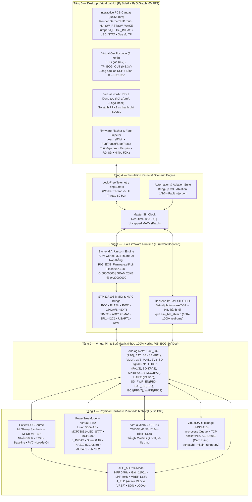
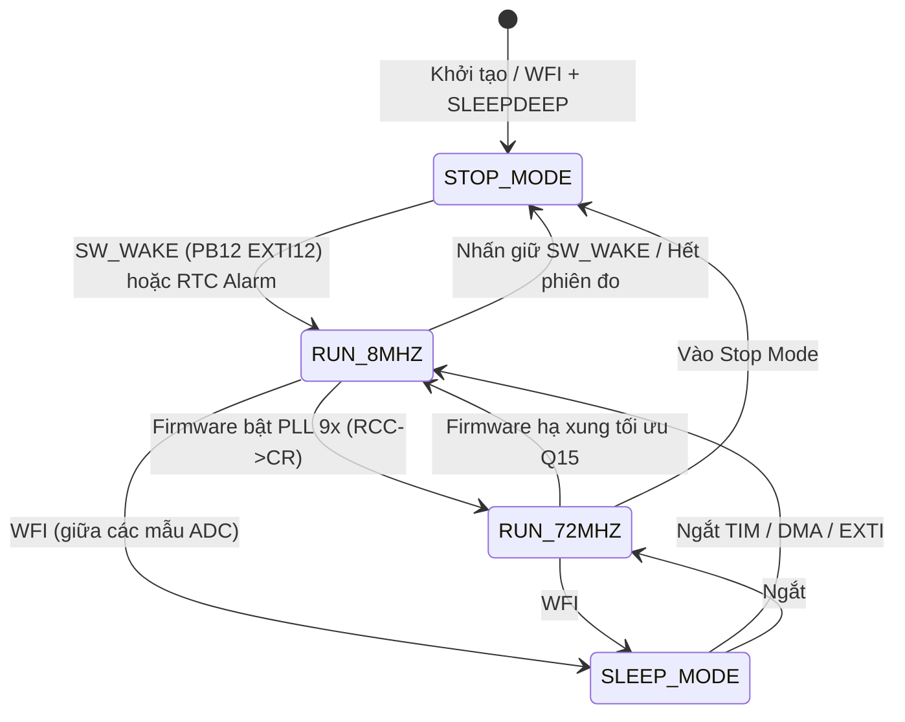
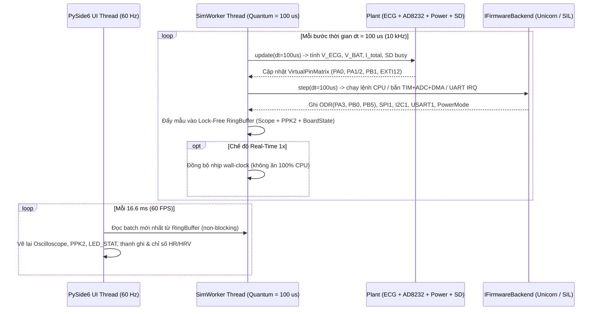

# Kiến trúc Khung Mô phỏng Phần cứng Ảo P05 (`P05-Sim` — Python Digital Twin)

> **Dự án:** P05 — Thiết bị đo ECG 1 đạo trình chạy pin (AD8232 + STM32F103C8T6)  
> **Trạng thái tài liệu:** Bản thiết kế khung kiến trúc (`v1.0` — Chưa sinh mã nguồn thực thi)  
> **Mục tiêu:** Đóng gói toàn bộ thiết kế phần cứng Gate G1/G2 thành một **Bo mạch Ảo (Virtual Hardware Twin)** chạy trên Python, cho phép **nạp trực tiếp firmware ARM Cortex-M3 (`.elf`/`.bin`) chạy như bo thật** đồng thời hỗ trợ **chế độ SIL tốc độ cao** và **Phòng Lab ảo 60 FPS (`PySide6 + PyQtGraph`)** để kiểm thử toàn bộ chuỗi Bring-up G3, 3 bài Ablation G4 và trình diễn bảo vệ đồ án.

---

## 1. Tầm nhìn & Nguyên tắc Thiết kế

Thay vì viết một mô phỏng thuật toán tách rời phần cứng, `P05-Sim` bám sát **đúng bo mạch thật `80.0 × 55.0 mm`** đã hoàn thành `ERC = 0` và `DRC = 0`:

1. **Một nguồn sự thật từ phần cứng thật (`Hardware-Derived Manifest`):** Hình học bo, tọa độ 91 linh kiện, giá trị điện trở/tụ điện và sơ đồ nối chân được nạp trực tiếp từ [P05_ECG_PickAndPlace.csv](../hardware/bom/P05_ECG_PickAndPlace.csv), [P05_ECG_BOM.xlsx](../hardware/bom/P05_ECG_BOM.xlsx), [P05_ECG_Gerber_JLCPCB.zip](../hardware/gerber/P05_ECG_Gerber_JLCPCB.zip) và [SPECIFICATION.md](./SPECIFICATION.md).
2. **Tách biệt hoàn toàn "Bo mạch Ảo (Plant)" và "Lõi chạy Firmware (Runtime)":** Mọi tương tác giữa MCU và phần cứng xung quanh đi qua một giao diện chân/bus chuẩn (`VirtualPinMatrix`). Nhờ đó, **2 backend thực thi** (`Unicorn ARM Cortex-M3` và `Fast SIL C-DLL`) dùng chung 100% mô hình vật lý (`AD8232`, `INA219`, `PowerTree`, `microSD`, `UART1`) và giao diện Lab.
3. **Không cần cài trình giả lập nặng bên ngoài:** Toàn bộ hệ thống cài đặt bằng Python (`pip install`), chạy mượt trên Windows 10/11.
4. **Kiểm chứng được mọi chỉ tiêu nghiệm thu G3 & G4:** Từ xung nhịp `MCO 8 MHz`, dòng ngủ sâu `Stop Mode ~32,1 µA`, độ phân giải `100 µA` của `INA219`, độ trễ ghi block `512 bytes` thẻ microSD, đến cả 3 thí nghiệm Ablation (`Q15` vs `Soft-Float`, `250 Hz` vs `500 Hz`, `Active RLD` vs `VREF Grounding`).

---

## 2. Kiến trúc 5 Tầng Tổng thể



---

## 3. Tầng 1 — Đóng gói Phần cứng & Mô hình Vật lý (`Board Bundle` & `Plant`)

### 3.1. Bộ trích xuất `Board Bundle` (`sim/board_bundle/`)
Một công cụ tiền xử lý (chạy một lần mỗi khi cập nhật mạch) đọc các sản phẩm Gate G2 hiện có để tạo ra **`board_manifest.json`** (chỉ đọc, không sửa file Altium):
- **Từ [P05_ECG_PickAndPlace.csv](../hardware/bom/P05_ECG_PickAndPlace.csv):** Tọa độ `(X, Y)` (mm), góc xoay, footprint của toàn bộ **91 linh kiện** (đặc biệt là tọa độ chính xác của `LED_STAT`, `SW_RST`, `SW_WAKE`, `J_RLD`, `J_IMEAS`, `J_USB`, `J_ECG`, `J_SD`, `TP_ECG_OUT`, `TP_MCO`, `TP_SD_EN`).
- **Từ [P05_ECG_BOM.xlsx](../hardware/bom/P05_ECG_BOM.xlsx):** Trị số thực tế của từng linh kiện (`R_SHUNT = 0.1 Ω`, `R_DIV1 = R_DIV2 = 100 kΩ`, `R_PROG = 4.7 kΩ`, `R_G1 = 1 MΩ`, `R_G2 = 100 kΩ`, `C_HP1/2 = 0.33 µF`, `C_LP1 = 1.5 nF`, `C_LP2 = 10 nF`, `R_LP1/2 = 1 MΩ`...).
- **Từ [hardware/gerber/raw/](../hardware/gerber/raw):** Đường viền bo `.GM1` (`80.0 × 55.0 mm`), lớp đồng `.GTL` và in lụa `.GTO` được raster hóa thành lớp nền ảnh tĩnh độ phân giải cao cho `Interactive PCB Canvas`.

### 3.2. Mô hình Bệnh nhân & AFE `AD8232` (`patient_ecg.py`, `afe_ad8232.py`)

| Khối con | Tham số vật lý khớp mạch P05 | Hành vi mô phỏng |
|---|---|---|
| **Nguồn ECG bệnh nhân** | 2 chế độ: **Synthetic (McSharry)** & **MIT-BIH (`wfdb`)** | Chỉnh trực tiếp `HR` (30–200 bpm), `HRV` (`SDNN`/`RMSSD`), biên độ `QRS` (`0.5–3 mV`), nhiễu lưới `50 Hz` (điều chỉnh biên độ mV), nhiễu cơ `EMG`, trôi đường nền hô hấp `0.2–0.3 Hz`, nhịp ngoại tâm thu `PVC`. |
| **Điện cực & `J_ECG`** | Công tắc gắn/tuột rời từng cực `RA`, `LA`, `RL` | Khi tuột `RA` hoặc `LA`, đẩy điện áp vào đầu vào lên rail và kéo `PA1 (ECG_LOD_P)` hoặc `PA2 (ECG_LOD_N)` lên `HIGH` (mô phỏng mạch kéo `R_LO_P/N = 10 MΩ`). |
| **Jumper `J_RLD` (3 chân)** | Vị trí `1-2`: **Active RLD** ↔ Vị trí `2-3`: **`VREF_1V65`** | Thay đổi hệ số triệt nhiễu đồng pha (`CMRR`): `Active RLD` triệt nhiễu 50 Hz mạnh (~80 dB); chuyển sang `VREF` làm suy giảm CMRR (~40–45 dB) để tái hiện **Ablation 3** y như rút/cắm jumper thật! |
| **Chuỗi khuếch đại & lọc `AD8232`** | `G_IA = 100`, `G_opamp = 1 + 1M/100k = 11` $\Rightarrow$ `Gain = 1100`; HPF 2 cực `~0.5 Hz`; LPF 2 cực `~40 Hz`; `VREF = 1.65 V`; `SNR`/nhiễu nội quy về đầu vào `~14 µVpp` | Tính đáp ứng rời rạc theo bước mô phỏng bằng bộ lọc IIR tương đương liên tục (bilinear transform), bão hòa mềm ở `[0.05 V, VDDA - 0.05 V]`, xuất điện áp lên net `ECG_OUT` (`PA0` & `TP_ECG_OUT`). |
| **Chế độ tắt `SDN` (`PA3`)** | Active-Low (`PA3 = 0` → Shutdown) | Khi `PA3 = 0`: dòng `AD8232` giảm từ `170 µA` xuống **`0.5 µA`**, ngõ ra `ECG_OUT` trở kháng cao (`High-Z` / tắt tín hiệu). |

### 3.3. Mô hình Chuỗi Nguồn, Pin & Đo dòng (`power_tree.py`, `ina219_dev.py`, `power_profiler.py`)



- **Pin Li-ion 1S (`500 mAh`):** Đường cong điện áp hở mạch `OCV(SoC)` từ `4.20 V` (100%) → `3.70 V` (50%) → `3.00 V` (0%), nội trở `R_int = 120 mΩ`. Hỗ trợ chỉnh nhanh mức pin trên UI để test cảnh báo pin yếu (`DETAIL_LOW_BATTERY`).
- **Cổng `J_USB` + Sạc `MCP73831` + `LED_STAT`:** Khi cắm USB 5V, dòng sạc `I_chg = 1000 / 4.7k ≈ 213 mA` (CC/CV), `STAT` kéo xuống mức thấp làm sáng đèn đỏ **`LED_STAT`** trên bo ảo; sạc đầy → tắt đèn.
- **LDO `MCP1700-3.3V`:** Điện áp `3V3_PRE = min(3.30 V, VBAT - V_drop)`, dòng tĩnh `I_q = 1.6 µA`.
- **Cầu đo pin (`2N7002` + `100 kΩ / 100 kΩ`):**
  - `PB5 (BAT_SENSE_EN) = HIGH` → `BAT_SENSE (PB1) = VBAT / 2`, dòng tiêu thụ thêm `VBAT / 200 kΩ ≈ 18.5 µA`.
  - `PB5 = LOW` → ngắt mạch, dòng rò **`0 µA`**, `PB1` nổi cao.
- **Công tắc nguồn thẻ SD (`AO3401` P-MOSFET):**
  - `PB0 (SD_PWR_EN) = LOW` → cấp `3V3_SD = 3.3 V` cho `VirtualMicroSD` (cần độ trễ nạp tụ `C_SD1 = 4.7 µF` khoảng `~1 ms`).
  - `PB0 = HIGH` → cắt sạch nguồn `3V3_SD = 0 V` (`I_SD = 0 µA`), mọi lệnh SPI gửi tới thẻ SD trả `0xFF` và thẻ mất trạng thái khởi tạo (phải `CMD0` lại khi bật nguồn!).
- **Slave I2C `INA219` (Địa chỉ `0x40`, Bus `I2C1` `PB6/PB7`):**
  - Cài đặt đầy đủ thanh ghi chuẩn datasheet: `0x00` (Configuration — hỗ trợ chế độ `Power-Down = 0b000` giảm dòng xuống `6 µA`), `0x01` (Shunt Voltage, LSB `10 µV` trên `R_SHUNT = 0.1 Ω` $\Rightarrow$ lượng tử hóa đúng **`100 µA`** như bo thật!), `0x02` (Bus Voltage, LSB `4 mV`), `0x03` (Power), `0x04` (Current), `0x05` (Calibration).
- **Tổng hợp Dòng `Virtual Nordic PPK2` (chèn tại Jumper `J_IMEAS`):**
  - Cộng dồn dòng thực tế của từng linh kiện theo đúng bảng ngân sách công suất [SPECIFICATION.md §4](./SPECIFICATION.md):
    - `STM32F103`: `Stop = 24.0 µA` | `Sleep 8MHz = 1.8 mA` | `Run 8MHz = 4.2 mA` | `Run 72MHz = 27.0 mA` (+ cộng phạt dòng rò nếu GPIO không đưa về `Analog Input` trước khi Stop!).
    - `MCP1700`: `1.6 µA` | `AD8232`: `0.5 µA` (SDN) / `170 µA` (Active) | `INA219`: `6.0 µA` (PD) / `700 µA` (Active) | `microSD`: `0 µA` (Off) / `0.5 mA` (Idle) / `25–45 mA` (xung ghi block `512 B` trong `2–20 ms`).
    - Kiểm chứng ngay trên Virtual PPK2: khi firmware tắt đúng hết ngoại vi và vào Stop Mode, đồ thị tụt về đúng **`~32.1 µA`** ($\le 48.15\ \mu\text{A}$)! Nếu firmware quên tắt `INA219` hay quên kéo `PB0 = HIGH`, dòng sẽ vọt lên và phát hiện lỗi ngay trên mô phỏng!

### 3.4. Mô hình Thẻ `microSD` SPI1 & Cầu nối `UART1` (`microsd_spi.py`, `uart_hil_bridge.py`)
- **`VirtualMicroSD` (`SPI1`: `PA4..PA7`, Mode 0):**
  - Máy trạng thái SDv2 SPI chuẩn: `CMD0` (Idle), `CMD8` (Voltage Check), `CMD55 + ACMD41` (Init), `CMD58` (OCR/CCS), `CMD17` (Read 512B), `CMD24` (Write 512B + token `0xFE` + Data Response `0x05` + busy `0x00` kéo dài **`2–20 ms`** có cấu hình xác suất stall `50 ms` để test tràn **Ping-Pong Double Buffer**!).
  - Dữ liệu ghi thật xuống file ảnh nhị phân `sim_sdcard.img` để module **`sd_inspector.py`** giải mã trực tiếp các block `512 bytes` (`"ECG5"`, `BLOCK_SEQ`, `FLAGS`, `CRC`) và kiểm tra tính toàn vẹn.
- **`VirtualUART1Bridge` (`USART1`: `PA9/PA10`):**
  - Nối byte TX/RX giữa MCU ảo và 2 kênh: (1) Terminal nội bộ trong Desktop UI, và (2) TCP server `127.0.0.1:5050` tương thích trực tiếp `pyserial` (`serial_for_url("socket://127.0.0.1:5050")`), giúp [scripts/hil_mitbih_runner.py](../scripts/hil_mitbih_runner.py) bơm trực tiếp MIT-BIH vào bo ảo mà không cần driver cổng COM ảo!

---

## 4. Tầng 2 — Ma trận Chân & Bus Ảo (`VirtualPinMatrix`)

Khớp 1-1 với bảng Pinout trong [SPECIFICATION.md §2](./SPECIFICATION.md) và netlist [P05_ECG.SchDoc](../hardware/P05_ECG/P05_ECG.SchDoc):

| Chân MCU | Net phần cứng | Kiểu tín hiệu | Thiết bị gắn trên bo ảo |
| :--- | :--- | :--- | :--- |
| `PA0` | `ECG_OUT` | Analog In (`0..3.3V`) | `AD8232` output + chốt đo `TP_ECG_OUT` |
| `PA1`, `PA2` | `ECG_LOD_P`, `ECG_LOD_N` | Digital In | `AD8232` Leads-Off comparators |
| `PA3` | `ECG_SDN` | Digital Out | `AD8232` Shutdown (active-low) |
| `PA4..PA7` | `SD_CS`, `SPI1_SCK/MISO/MOSI` | SPI1 Bus | `VirtualMicroSD` (`J_SD`) |
| `PA8` | `MCO_OUT` | Clock Out | Chốt đo tần số `TP_MCO` (`8 MHz` HSE) |
| `PA9`, `PA10` | `DBG_TX`, `DBG_RX` | UART1 Bus | `VirtualUART1Bridge` (`J_UART`) |
| `PB0` | `SD_PWR_EN` | Digital Out | Gate P-MOSFET `AO3401` + chốt đo `TP_SD_EN` |
| `PB1` | `BAT_SENSE` | Analog In (`0..3.3V`) | Cầu chia `100k/100k` đo `VBAT/2` |
| `PB5` | `BAT_SENSE_EN` | Digital Out | Gate N-MOSFET `2N7002` |
| `PB6`, `PB7` | `I2C1_SCL`, `I2C1_SDA` | I2C1 Bus | `INA219` Slave (`0x40`) |
| `PB12` | `WAKE_BTN` | Digital In (`EXTI12`) | Nút nhấn `SW_WAKE` (pull-up `100k`, tụ `100nF`) |
| `NRST` | `NRST` | System Reset | Nút nhấn cứng `SW_RST` (reset tức thì MCU) |

---

## 5. Tầng 3 — Lõi thực thi Firmware 2 Chế độ (`IFirmwareBackend`)

### 5.1. Hợp đồng Giao diện chung (`backend_base.py`)
Mọi backend đều cài đặt đúng 1 lớp trừu tượng `IFirmwareBackend`:
- `load_firmware(path: Path) -> FirmwareInfo` *(nạp `.elf`/`.bin`/`.hex` hoặc `.dll`, đọc symbol table & kích thước Flash/SRAM)*
- `attach_matrix(matrix: VirtualPinMatrix) -> None`
- `reset() -> None` *(đọc SP tại `0x08000000`, Reset Vector tại `0x08000004`)*
- `step(dt_us: float) -> StepTelemetry` *(chạy MCU tiến thêm `dt_us` theo đồng hồ mô phỏng, trả về trạng thái `RUN/SLEEP/STOP`, số lệnh/chu kỳ, ngắt đã xử lý)*
- `get_cpu_snapshot() -> CpuSnapshot` *(PC, SP, LR, tần số SYSCLK, `DWT->CYCCNT`, trạng thái Power Mode, lỗi HardFault/Stack Overflow nếu có)*

### 5.2. Backend A — Unicorn Engine ARM Cortex-M3 (`unicorn_backend.py` + `stm32f103_mmio.py`)
Nạp trực tiếp file **`P05_ECG_Firmware.elf`** / **`.bin`** biên dịch bởi `arm-none-eabi-gcc` theo đúng bản đồ bộ nhớ [STM32F103C8Tx_FLASH.ld](../firmware/STM32F103C8Tx_FLASH.ld):
- **`FLASH` (`0x08000000`, `64 KB`, RX):** Nạp toàn bộ `.isr_vector`, `.text`, `.rodata`, `_sidata`; alias `0x00000000` về `0x08000000` khi `BOOT0 = 0`.
- **`SRAM` (`0x20000000`, `20 KB`, RWX):** Giám sát tự động **Stack Watermark** (cảnh báo ngay nếu `SP` chạm dưới `0x20004800` vượt mức `_Min_Stack_Size = 2 KB` hoặc cố gọi `malloc` vi phạm `ZERO_HEAP_ARCH`!).
- **Bản đồ thanh ghi MMIO tối thiểu cần mô phỏng (`stm32f103_mmio.py`):**

| Ngoại vi | Địa chỉ nền (`Base`) | Thanh ghi cốt lõi | Cơ chế nối vào `VirtualPinMatrix` |
| :--- | :--- | :--- | :--- |
| **`RCC`** | `0x40021000` | `CR`, `CFGR`, `APB2ENR`, `APB1ENR`, `AHBENR`, `BDCR` | Tự động set cờ `HSERDY`/`PLLRDY`/`LSERDY`; tính `SYSCLK` (`8 MHz` hay `72 MHz`) và cập nhật tần số `TP_MCO` (`PA8`) + dòng tiêu thụ MCU. |
| **`FLASH`** | `0x40022000` | `ACR` | Chấp nhận cấu hình Wait States (`LATENCY=2` cho 72 MHz). |
| **`PWR`** | `0x40007000` | `CR`, `CSR` | Kết hợp `SCB->SCR.SLEEPDEEP` + lệnh `WFI` để chuyển `PowerTreeModel` sang **`SLEEP`** hoặc **`STOP (24 µA)`**. |
| **`GPIOA`, `GPIOB`** | `0x40010800`, `0x40010C00` | `CRL`, `CRH`, `IDR`, `ODR`, `BSRR`, `BRR` | Đọc/ghi trạng thái chân số; **kiểm tra cấu hình `CNF=00, MODE=00` (Analog Input)** ở `Stop Mode` để mô phỏng dòng rò thật nếu cấu hình sai! |
| **`AFIO`, `EXTI`** | `0x40010000`, `0x40010400` | `EXTICR4`, `IMR`, `FTSR`, `RTSR`, `PR` | Bắt sườn nhấn nút `SW_WAKE` (`PB12` → `EXTI12`) để đánh thức MCU khỏi `Stop Mode` và bắn ngắt `EXTI15_10_IRQn`. |
| **`TIM2` / `TIM3`** | `0x40000000`, `0x40000400` | `CR1`, `CR2 (MMS=TRGO)`, `PSC`, `ARR`, `CNT`, `SR`, `DIER` | Sinh nhịp lấy mẫu cứng `250 Hz` hoặc `500 Hz` (jitter = 0) kích hoạt `ADC1` (`TRGO`) hoặc ngắt timer. |
| **`ADC1` + `DMA1`** | `0x40012400`, `0x40020000` | `ADC1: SR, CR1, CR2, SQR3, DR` • `DMA1_Ch1: CCR, CNDTR, CPAR, CMAR, ISR, IFCR` | Mỗi nhịp `TRGO`, lấy điện áp `PA0` (`ECG_OUT`) lượng tử hóa 12-bit (`0..4095`), ghi thẳng vào buffer Ping-Pong trong SRAM và bắn ngắt **`HTIF` (Half-Transfer)** / **`TCIF` (Transfer-Complete)** (`DMA1_Channel1_IRQn`)! |
| **`SPI1`** | `0x40013000` | `CR1`, `CR2`, `SR (TXE/RXNE/BSY)`, `DR` | Mỗi lần ghi `DR`, trao đổi 1 byte đồng bộ với `VirtualMicroSD` (nếu `PA4 SD_CS = LOW` và `3V3_SD > 2.7 V`). |
| **`I2C1`** | `0x40005400` | `CR1`, `CR2`, `SR1`, `SR2`, `DR`, `CCR` | Chuyển tiếp giao dịch `START / ADDR(0x40) / TX / RX / STOP` tới `INA219` (trả `AF` NACK nếu địa chỉ sai hoặc bus lỗi). |
| **`USART1`** | `0x40013800` | `SR (TXE/TC/RXNE)`, `DR`, `BRR`, `CR1` | Gửi/nhận khung nhị phân HIL với `VirtualUART1Bridge`; bắn ngắt `USART1_IRQn` khi có byte mới từ `hil_mitbih_runner.py`. |
| **`SCB / NVIC / SysTick / DWT`** | `0xE000E000`, `0xE0001000` | `NVIC_ISER/ICER`, `SCR`, `SYST_*`, `DWT_CTRL`, **`DWT_CYCCNT` (`0xE0001004`)** | Điều phối vào/ra ngắt chuẩn ARMv7-M (`EXC_RETURN 0xFFFFFFF9` stack frame) và đếm chu kỳ thực thi cho **Ablation 1 (`Q15` vs `Soft-Float`)**. |

> **Lưu ý kỹ thuật minh bạch về Unicorn Engine:**
> - **Ngắt (Interrupt Injection):** Unicorn mặc định không tự động đẩy khung ngắt ARMv7-M như phần cứng NVIC; `stm32f103_mmio.py` sẽ cài bộ điều phối `CortexM3Nvic` (~120 dòng) tự thực hiện chuẩn stack-push `xPSR, PC, LR, R12, R3..R0` và intercept `EXC_RETURN` khi trả về từ ISR.
> - **Độ chính xác `DWT->CYCCNT`:** Đếm theo số lệnh Thumb-2 thực thi kèm trọng số chu kỳ cơ bản (`1 cycle` ALU/shift, `2–3 cycles` LDR/STR/branch, `~30–120 cycles` cho hàm soft-float `__aeabi_fmul/fadd`). Giá trị này phản ánh **đúng tỷ lệ tăng tốc `Q15` vs `Soft-Float`** khi mô phỏng, còn số tuyệt đối dùng cho bài báo G4 sẽ được đối chiếu lại trên chip thật ở Gate G3/G4.

### 5.3. Backend B — Fast SIL C-DLL (`sil_backend.py`)
- Biên dịch nguyên mã C portable (`firmware/DSP/*.c` + `firmware/HIL/*.c`) cùng một file mỏng `sim/mcu/sil_hal_shim.c` (cài đúng 6 header `firmware/Core/*.h`: `ADC_DMA_*`, `SPI_SD_*`, `INA219_*`, `UART_Dbg_*`, `DWT_Cycle_*`) thành `p05_sil.dll` (MinGW/Clang) và gọi qua Python `ctypes`.
- **Tác dụng:** Chạy toàn bộ 48 bản ghi 30 phút của **MIT-BIH Arrhythmia Database** (tương đương 24 giờ tín hiệu ECG) chỉ trong **vài giây**, phục vụ tinh chỉnh thuật toán Pan–Tompkins, nội suy Parabol và chạy `bland_altman_eval.py` cực nhanh trước khi xác nhận lại bằng `.elf` trên Unicorn!

---

## 6. Tầng 4 — Đồng bộ Thời gian & Luồng Chạy (`SimClock` & Threading)



- **Hai tốc độ đồng hồ:**
  - **`Real-Time (1×)`:** Dùng khi trình diễn GUI — sóng ECG chạy đúng nhịp tim thực tế (72 nhịp/phút), bấm nút `SW_WAKE` phản hồi tức thì, đèn `LED_STAT` sáng/tắt tự nhiên.
  - **`Fast / Headless (MAX×)`:** Tắt giới hạn wall-clock để chạy kịch bản tự động (`bringup_g3.py`, `ablation_suite.py`, `fault_injection.py`) nhanh nhất có thể và xuất trực tiếp file CSV vào `data/test/`.

---

## 7. Tầng 5 — Thiết kế Giao diện Desktop Lab (`PySide6 + PyQtGraph`)

Bố cục màn hình chính chia thành **4 khu vực trực quan** (chế độ nền tối kiểu thiết bị phòng thí nghiệm):

| Khu vực | Thành phần chính | Tương tác của người dùng |
|---|---|---|
| **1. Góc trên-trái: Interactive PCB Canvas (`80 × 55 mm`)** | Hiển thị chính bo mạch P05 (từ Gerber + PnP thật) | Click bấm **`SW_RST`**, **`SW_WAKE`**; click gạt jumper **`J_RLD`** (`Active RLD` / `VREF`); click cắm/rút **`J_USB`**, **`J_ECG`**, **`J_SD`**; xem đèn **`LED_STAT`** sáng/tắt; hover chuột lên **`TP_ECG_OUT`**, **`TP_MCO`**, **`TP_SD_EN`** xem điện áp/tần số tức thời! |
| **2. Góc trên-phải: Virtual Oscilloscope (`PyQtGraph`)** | 3 đường sóng cuộn mượt 60 FPS + bảng chỉ số lớn | Kênh 1: ECG đầu vào (mV); Kênh 2: `TP_ECG_OUT` (0–3.3V); Kênh 3: Ngõ ra DSP + **marker đỉnh R** + bảng **`HR (bpm)`**, **`RR (ms)`**, **`SDNN`**, **`RMSSD`**, **`pNN50`** + cờ `Leads-Off`. |
| **3. Góc dưới-phải: Virtual Nordic PPK2 (`PyQtGraph`)** | Đồ thị dòng tiêu thụ toàn mạch theo thời gian (thang Log `1 µA → 100 mA`) | Hiển thị dòng tức thời (`µA`/`mA`), dòng trung bình, **ước tính thời lượng pin còn lại (giờ)**, so sánh trực tiếp **PPK2 thật ảo vs giá trị đọc từ `INA219`** và bảng phân rã dòng từng IC (`MCU`, `AD8232`, `INA219`, `SD`, `LDO`). |
| **4. Góc dưới-trái: Control Dock (4 tab gọn)** | **Tab 1 — Firmware:** Load `.elf`/`.bin`/`.dll`, chọn Backend (`Unicorn`/`SIL`), nút `Flash`, `Reset`, `Run/Pause`, `Step`, xem `PC/SP/SYSCLK/DWT->CYCCNT`.<br>**Tab 2 — Patient & Faults:** Thanh trượt `HR`, `Nhiễu 50Hz`, `EMG`, `Pin %`, nút kích tuột `RA/LA`, nút chọn bản ghi `MIT-BIH`.<br>**Tab 3 — Serial/HIL Console:** Xem luồng gói tin `UART1`, bật/tắt TCP Bridge `127.0.0.1:5050`.<br>**Tab 4 — SD Inspector:** Xem số block `512 B` đã ghi lên `sim_sdcard.img`, kiểm tra `CRC` & `BLOCK_SEQ`. | Chuyển đổi linh hoạt mà không làm rối màn hình trình diễn. |

---

## 8. Cấu trúc Thư mục Khung (`sim/`) & Phụ thuộc Python

```text
F:\New folder (2)\
├── hardware/                    # Gate G1 + G2 (đã hoàn thành: ERC=0, DRC=0, Gerber, BOM)
├── firmware/                    # Firmware C STM32F103C8T6 -> build .elf / .bin
├── scripts/                     # hil_mitbih_runner.py, bland_altman_eval.py, power_profiler.py
├── docs/
│   └── SIM_ARCHITECTURE.md      # <--- Tài liệu kiến trúc khung này
└── sim/                         # Gói Python Digital Twin (P05-Sim)
    ├── requirements-sim.txt     # PySide6, pyqtgraph, numpy, scipy, unicorn, pyelftools, wfdb, pyyaml
    ├── __init__.py
    ├── main.py                  # Điểm khởi chạy CLI (--headless / --gui / --scenario)
    ├── board_bundle/
    │   ├── extract_manifest.py  # Trích xuất board_manifest.json + ảnh nền PCB từ hardware/bom & gerber
    │   └── board_manifest.json  # Dữ liệu bo 80x55mm, 91 linh kiện, trị số BOM, pinout
    ├── core/
    │   ├── sim_clock.py         # Master SimClock (1x / MAXx) & Quantum scheduler
    │   ├── pin_matrix.py        # VirtualPinMatrix (Analog/Digital/Power/SPI/I2C/UART nets)
    │   └── telemetry.py         # Lock-free ring buffers cho UI & CSV logger
    ├── plant/
    │   ├── patient_ecg.py       # Synthetic McSharry ECG + WFDB MIT-BIH + 50Hz/EMG/Baseline/PVC
    │   ├── afe_ad8232.py        # AD8232 physical filter/gain + J_RLD + SDN + Leads-Off
    │   ├── power_tree.py        # Li-ion 500mAh + MCP73831 + LED_STAT + MCP1700 + AO3401 + 2N7002
    │   ├── ina219_dev.py        # INA219 I2C1 slave (0x40)
    │   ├── microsd_spi.py       # microSD SPI1 block-512B + realistic write latency -> .img
    │   └── power_profiler.py    # Virtual Nordic PPK2 current aggregator
    ├── mcu/
    │   ├── backend_base.py      # Abstract IFirmwareBackend + FirmwareInfo + CpuSnapshot
    │   ├── cortex_m3_nvic.py    # Bộ điều phối ngắt ARMv7-M (EXC_RETURN, SysTick, DWT->CYCCNT)
    │   ├── stm32f103_mmio.py    # Bản đồ thanh ghi 10 ngoại vi STM32F103C8T6
    │   ├── unicorn_backend.py   # Chạy trực tiếp file .elf / .bin ARM Cortex-M3
    │   ├── sil_backend.py       # Gọi p05_sil.dll qua ctypes (chế độ batch tốc độ cao)
    │   └── sil_hal_shim.c       # Lớp cầu C nối firmware/DSP+HIL với sil_backend.py
    ├── bridges/
    │   ├── uart_hil_bridge.py   # TCP socket://127.0.0.1:5050 <-> USART1 cho hil_mitbih_runner.py
    │   └── sd_inspector.py      # Giải mã & kiểm tra CRC/Seq các khối 512B trong sim_sdcard.img
    ├── scenarios/
    │   ├── bringup_g3.py        # Tự động chạy checklist Bring-up G3 (MCO, I2C, SD, AFE, Stop 32uA)
    │   ├── ablation_suite.py    # Tự động chạy Ablation 1 (Q15/Float), 2 (250/500Hz), 3 (RLD/VREF)
    │   └── fault_injection.py   # Bộ test lỗi: tuột điện cực, rút SD, sụt pin, sai CRC UART
    └── ui/
        ├── main_window.py       # Cửa sổ chính PySide6 + Worker thread controller
        ├── pcb_canvas.py        # Bo mạch 80x55mm tương tác (nút nhấn, jumper, LED, que đo)
        ├── scope_view.py        # Oscilloscope PyQtGraph 60 FPS (ECG + R-Peak + HRV)
        ├── ppk2_view.py         # Virtual PPK2 Power Profiler (thang Log uA/mA)
        └── control_dock.py      # Flasher, Patient/Fault Controls, Serial Console, SD Inspector
```

---

## 9. Lộ trình Triển khai 5 Giai đoạn (Incremental Milestones)

Mỗi giai đoạn đều có tiêu chí nghiệm thu rõ ràng và chạy kiểm chứng độc lập bằng `pytest` trước khi chuyển bước:

| Giai đoạn | Hạng mục xây dựng | Tiêu chí hoàn thành (Exit Criteria) |
| :---: | :--- | :--- |
| **P1 — Board Bundle & Plant** | `extract_manifest.py`, `VirtualPinMatrix`, `patient_ecg.py`, `afe_ad8232.py`, `power_tree.py`, `ina219_dev.py`, `microsd_spi.py`, `power_profiler.py` | Chạy headless không cần MCU: xác nhận `J_RLD` chuyển đổi giảm nhiễu 50 Hz đúng kỳ vọng; `PA3=0` + `PB0=1` + `INA219 PD` cho tổng dòng **`32.1 µA`**; ghi/đọc được khối `512 B` vào `sim_sdcard.img`. |
| **P2 — Fast SIL Backend** | `backend_base.py`, `sil_hal_shim.c`, `sil_backend.py`, `uart_hil_bridge.py` | Biên dịch được `firmware/DSP` + `firmware/HIL` thành DLL; bơm bản ghi MIT-BIH 100 qua `hil_mitbih_runner.py` (TCP `127.0.0.1:5050`) và tính được `Se / PPV / MAE_RR`. |
| **P3 — Unicorn ARM Cortex-M3** | `cortex_m3_nvic.py`, `stm32f103_mmio.py`, `unicorn_backend.py` | Nạp được **file `.elf`/`.bin` ARM thật** build từ `arm-none-eabi-gcc`: chạy được `RCC -> GPIO -> TIM+ADC+DMA -> I2C INA219 -> SPI SD -> UART1 -> WFI Stop Mode`, đọc được `DWT->CYCCNT` khác biệt giữa `Q15` và `Soft-Float`. |
| **P4 — Desktop Lab UI** | `PySide6 + PyQtGraph` (`pcb_canvas`, `scope_view`, `ppk2_view`, `control_dock`) | Mở app hiển thị đúng bo `80 × 55 mm` của P05; bấm `SW_WAKE` đánh thức mạch từ `32 µA` lên `Run`, gạt `J_RLD` thấy sóng nhiễu 50 Hz thay đổi trực tiếp trên Oscilloscope 60 FPS, kéo tuột điện cực `RA` thấy báo `Leads-Off` ngay lập tức! |
| **P5 — Kịch bản G3 & G4** | `bringup_g3.py`, `ablation_suite.py`, `fault_injection.py`, `sd_inspector.py` | Một lệnh chạy tự động toàn bộ bài test Bring-up G3 + 3 Ablation G4 và xuất sẵn biểu đồ/CSV đối chiếu vào `data/test/`. |
