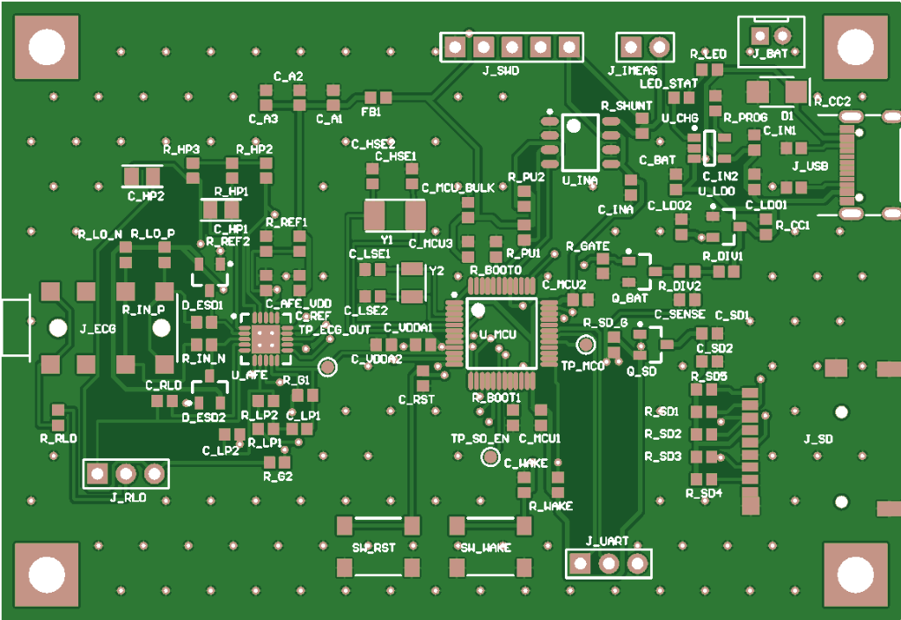
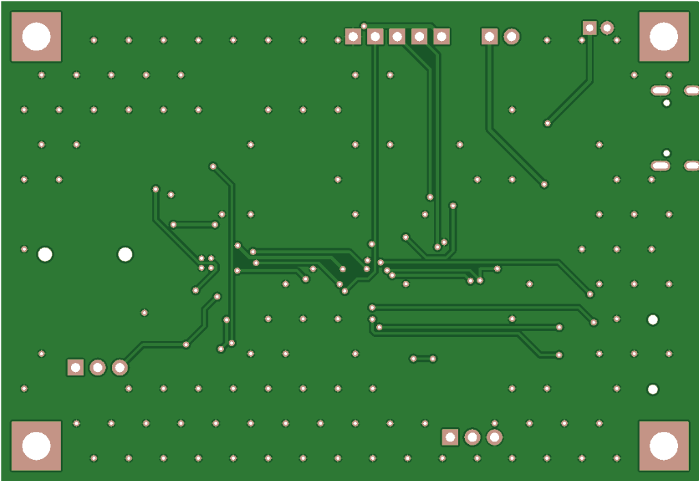

# P05 - Battery-Powered Single-Lead ECG & On-Device Fixed-Point HRV Monitor

[](docs/SPECIFICATION.md)
[](docs/SPECIFICATION.md)
[](hardware/P05_ECG.PcbDoc)
[](hardware/P05_ECG/P05_ECG.SchDoc)
[](hardware/gerber/Design%20Rule%20Check%20-%20P05_ECG.drc)
[](docs/SPECIFICATION.md)

Single-lead ECG acquisition and on-device real-time HRV monitor built on STM32F103C8T6 (ARM Cortex-M3 at 72 MHz, no FPU) and the AD8232 analog front-end. Designed for zero-heap Q15 fixed-point DSP, parabolic sub-sample R-peak interpolation, automated MIT-BIH Hardware-in-the-Loop (HIL) testing, and low-power battery operation.

---

## PCB Layout (JLCPCB Gerber Render, 80.0 x 55.0 mm, 2-Layer)

| Top Layer (4-Zone Partitioned Layout) | Bottom Layer (Solid GND Plane >90%, 125 Stitching Vias) |
| :---: | :---: |
|  |  |

---

## Engineering Summary

### 1. Hardware & 2-Layer Mixed-Signal PCB (ERC = 0, DRC = 0)
- Spatial partitioning (80.0 x 55.0 mm, 91 components): Analog AFE (AD8232, BAV199 ESD, J_ECG, J_RLD) placed on the left (X < 28 mm); MCU, 8 MHz HSE / 32.768 kHz LSE crystals, SPI microSD, and power/charger circuitry placed on the right (X > 31 mm).
- Grounding and EMC: Single bottom GND plane (>90% unbroken) with 125 GND stitching vias and zero digital traces crossing into the analog zone. VDDA is isolated through Ferrite Bead FB1 (600 Ohm at 100 MHz) with 1 uF / 100 nF / 10 nF decoupling.
- Analog and clock routing: Symmetric differential ECG input traces (0 vias), 3-pin jumper J_RLD selecting Active RLD vs. VREF_1V65 grounding for CMRR ablation, and planar 0-crossing routing for Y1 (8 MHz) and Y2 (32.768 kHz) over solid ground.
- Low-power supply tree (32.1 uA Stop Mode target):
  + 1S Li-ion charging via USB-C (5V only) -> MCP73831 (R_PROG = 4.7 kOhm) + SMAJ5.0A TVS.
  + MCP1700-3.3V LDO (1.6 uA Iq) -> J_IMEAS (Nordic PPK2 header) -> 0.1 Ohm shunt + INA219 (I2C1) current monitor.
  + High-side P-MOSFET AO3401 (PB0) cuts 3V3_SD to microSD during sleep (0 uA leak); low-side N-MOSFET 2N7002 (PB5) disconnects the 100 kOhm / 100 kOhm battery divider when idle.
- EDA automation: Altium DelphiScripts ([AutoPlace_P05.pas](hardware/P05_ECG/AutoPlace_P05.pas), [RouteCritical_P05.pas](hardware/P05_ECG/RouteCritical_P05.pas), [FixDRC_P05.pas](hardware/P05_ECG/FixDRC_P05.pas)) for collision-free placement, critical analog/crystal pre-routing, and silkscreen/DRC cleanup.

### 2. System Architecture

```text
[Li-ion 1S 500mAh] <-- [USB-C 5V + SMAJ5.0A + MCP73831]
        |
        v
[MCP1700-3.3V] --> [J_IMEAS (PPK2)] --> [0.1 Ohm Shunt + INA219 (I2C1)]
                                                  |
            +-------------------------------------+--------------------------+
            v (3V3_MAIN)                                                     v (VDDA via FB1 + LC)
+---------------------------+                                    +--------------------------+
|  STM32F103C8T6 (LQFP-48)  |<---- PA0 (ADC1_IN0) ---------------|  AD8232 AFE (LFCSP-20)   |
|  - 8MHz HSE + 32.768kHz   |<---- PA1, PA2 (LOD+, LOD-) --------|  - BAV199 ESD Protection |
|  - Zero-Heap Q15 DSP      |----- PA3 (ECG_SDN) --------------->|  - J_RLD (Active / VREF) |
|  - Ping-Pong DMA + DWT    |                                    +--------------------------+
+--+----------+----------+--+
   |          |          +--> PB0 (AO3401 Power-Gate) --> [microSD TF-01A (SPI1, 512B Blocks)]
   |          +-------------> PA9, PA10 (UART1 HIL)   --> [MIT-BIH Automated Testbench]
   +------------------------> PA13, PA14, NRST (SWD) + PB12 (SW_WAKE EXTI12) + PA8 (TP_MCO)
```

---

## Target Acceptance KPIs & Power Budget

| Metric | Acceptance Target (Gate G4) | Verification Method |
| :--- | :--- | :--- |
| Input-Referred Noise | <= 30 uVpp (0.5-40 Hz) | Function Generator + 1000:1 Attenuator + Oscilloscope |
| R-Peak Detection (Se, PPV) | >= 99% on selected records | MIT-BIH Arrhythmia Database via UART1 HIL ([hil_mitbih_runner.py](scripts/hil_mitbih_runner.py)) |
| RR Interval Error (MAE_RR) | <= 5 ms (sub-sample parabolic) | Polar H10 reference + Bland-Altman (LoA 95% HR within +/-2 bpm) |
| Stop Mode Current | <= 48.15 uA (32.1 uA typical) | Nordic PPK2 via J_IMEAS (MCU 24 uA + LDO 1.6 uA + AFE 0.5 uA + INA219 PD 6 uA + SD 0 uA) |
| Active Battery Life (500 mAh) | ~52.6 h (8 MHz Q15 + Sleep) vs ~13.1 h (72 MHz Soft-Float) | Ablation 1 (DWT->CYCCNT + PPK2 profiling) |

---

## Project Deliverables & Status

| Gate | Milestone | Status | Key Artifacts |
| :---: | :--- | :---: | :--- |
| G1 | Schematic, Library & Power Budget | Completed | [P05_ECG.SchDoc](hardware/P05_ECG/P05_ECG.SchDoc) (ERC = 0), [SPECIFICATION.md](docs/SPECIFICATION.md) |
| G2 | 2-Layer PCB Layout & Fabrication Pack | Completed | [P05_ECG.PcbDoc](hardware/P05_ECG.PcbDoc) (DRC = 0), [Gerber + Drill ZIP](hardware/gerber/P05_ECG_Gerber_JLCPCB.zip), [BOM (.xlsx)](hardware/bom/P05_ECG_BOM.xlsx), [Pick & Place (.csv)](hardware/bom/P05_ECG_PickAndPlace.csv), [DRC Report](hardware/gerber/Design%20Rule%20Check%20-%20P05_ECG.drc) |
| Sim | Python Virtual Hardware Twin (P05-Sim) | Phase 1 & 3 Done | [SIM_ARCHITECTURE.md](docs/SIM_ARCHITECTURE.md), [sim/](sim/) (Virtual Board + Unicorn ARM Cortex-M3 + STM32F103 MMIO, 7/7 tests passing) |
| G3 | PCB Assembly & Driver Bring-up | Next | [G3_bringup.md](docs/G3_bringup.md), [firmware/](firmware/CMakeLists.txt) |
| G4 | MIT-BIH HIL, 3 Ablations & Paper | Planned | [G4_acceptance_paper.md](docs/G4_acceptance_paper.md), [scripts/](scripts/) |

---

## Repository Structure

```text
├── hardware/
│   ├── P05_ECG/                 # Altium project (.PrjPcb, .SchDoc, .SchLib, .PcbLib, DelphiScripts)
│   ├── P05_ECG.PcbDoc           # Verified 2-layer 80x55mm PCB (DRC = 0 violations)
│   ├── gerber/                  # JLCPCB-ready Gerber RS-274X + NC Drill (PTH/NPTH/Slots) ZIP & DRC report
│   ├── bom/                     # BOM (43 line items / 91 parts) & Pick-and-Place CSV
│   └── DataSheet/               # Reference datasheets for ICs and connectors
├── sim/                         # Python virtual board twin (board bundle, plant models, Unicorn Cortex-M3, tests)
├── firmware/                    # STM32F103C8T6 CMake zero-heap firmware (Core/, DSP/, HIL/)
├── scripts/                     # MIT-BIH HIL runner, Bland-Altman evaluator, power profiler
└── docs/                        # Specification, Gate G1-G4 checklists, SIM_ARCHITECTURE.md & PCB renders
```

---

<p align="center">
  <br/>
  <sub>Scan QR for full portfolio: <a href="https://github.com/XuanBau011205/bau-portfolio">https://github.com/XuanBau011205/bau-portfolio</a></sub>
</p>
